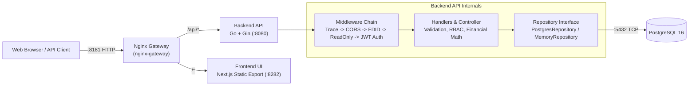
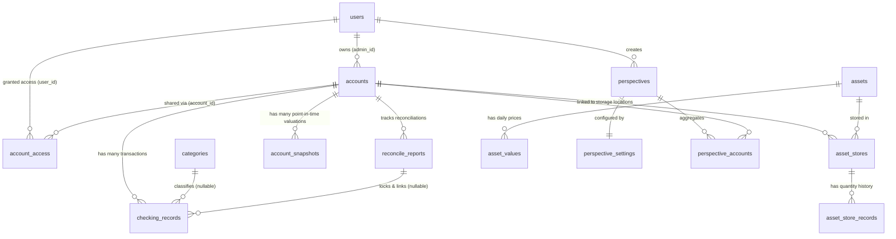
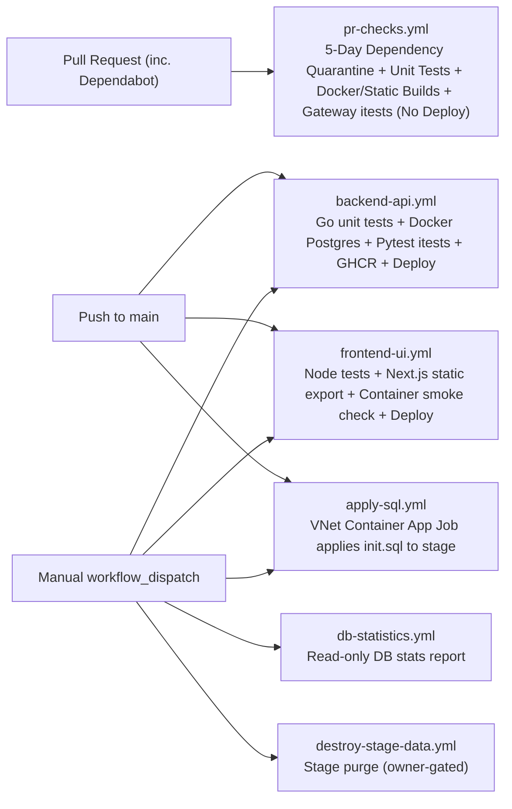

# Planned Wallet (`plannedwallet-ai`)

A full-stack personal wealth, ledger, asset portfolio, reconciliation, and financial forecasting platform built with **Go (Gin)**, **Next.js / React (TypeScript)**, **PostgreSQL 16**, and **Nginx**, with automated **Pytest + Playwright** integration testing and **GitHub Actions** CI/CD workflows.

---

## Architecture

Planned Wallet uses a multi-container 3-tier architecture fronted by an Nginx reverse proxy (`:8181`) in local Docker Compose deployments (and Azure Container Apps / Static Storage + Azure Front Door in cloud environments):



### Architectural Highlights
- **MVC & Dual-Repository Parity**: HTTP translation lives in `internal/handlers`, business rules and access control live in `internal/controller`, and persistence sits behind a single `repository.Repository` interface implemented with identical behavior in both `PostgresRepository` and `MemoryRepository` (enabling fast unit tests without a database).
- **W3C Observability**: Requests require `X-Client-ID` and propagate W3C `traceparent` headers end-to-end from `tracedFetch` in the frontend through backend middleware into structured logs.
- **Static Export Frontend**: Next.js compiles to static HTML/JS/CSS (`frontend-ui/out`), served by Nginx and backed by client-side React routing.
- **Contract-First Docs**: REST contracts and schema specs are maintained alongside code in [`backend-api/schema.yml`](backend-api/schema.yml) (OpenAPI 3.2.0), [`schema.md`](schema.md), and [`backend-api/schema.md`](backend-api/schema.md).

---

## Repository Structure

```text
├── .github/
│   ├── scripts/                  # Azure SQL migration & inspection helpers
│   └── workflows/                # GitHub Actions CI/CD & ops workflows
├── backend-api/                  # Go microservice (Gin + PostgreSQL / In-Memory)
│   ├── internal/
│   │   ├── auth/                 # JWT issuing/validation & RFC 6238 TOTP helpers
│   │   ├── captcha/              # Visual CAPTCHA challenge generator & repository store
│   │   ├── controller/           # Business logic, RBAC checks, financial calculations
│   │   ├── cors/                 # Allowed host & CORS preflight middleware
│   │   ├── database/             # Connection pool, retry logic, and init.sql DDL
│   │   ├── handlers/             # Gin routes, handlers, read-only & feature endpoints
│   │   ├── models/               # Domain models, DTOs, feature constants, errors
│   │   ├── repository/           # Repository interface, PostgresRepo, MemoryRepo
│   │   └── trace/                # W3C traceparent middleware & structured logger
│   ├── Dockerfile                # Multi-stage Go production container
│   ├── Makefile                  # Backend build, test, and Swagger UI commands
│   ├── main.go                   # Service bootstrap & environment wiring
│   ├── schema.md                 # Service copy of database & API docs
│   └── schema.yml                # OpenAPI 3.2.0 contract specification
├── frontend-ui/                  # Next.js / React / TypeScript web application
│   ├── app/                      # App shell, layout, and domain stylesheets (app/styles/)
│   ├── components/               # UI views, charts, reconciliation, modals, DateInput
│   ├── lib/                      # Typed API client, trace propagation, CSV parser, math
│   ├── Dockerfile                # Node static build + Nginx runtime container
│   ├── Makefile                  # Install, test, build, dev, docker-build targets
│   └── nginx.conf                # Frontend container static serving configuration
├── itests/                       # End-to-end API integration test suite
│   ├── conftest.py               # Auth fixtures, TOTP helpers, Playwright contexts
│   ├── test_*.py                 # Suites for auth, accounts, assets, categories, reconcile, etc.
│   └── Makefile                  # Python virtualenv setup & pytest runner
├── nginx-gateway/                # Local reverse proxy routing /api and /
│   ├── Dockerfile                # Gateway image definition
│   ├── Makefile                  # Gateway build/start helpers
│   └── nginx.conf                # Reverse proxy configuration (:8181)
├── docker-compose.yml            # Local full-stack orchestration (Postgres, API, UI, Gateway)
├── Makefile                      # Top-level lifecycle commands
├── schema.md                     # Database architecture & API reference
├── FEATURES.md                   # Detailed technical statement of capabilities
└── AGENTS.md                     # Repository coding standards and engineering rules
```

---

## Core Features

### Security & Access Control
- **User Authentication & MFA**: Self-registration (`POST /api/v1/users`) with BCrypt password hashing and mandatory **RFC 6238 TOTP** secret provisioning, plus credential exchange (`POST /api/v1/users/{username}/token`) issuing signed JWT bearer tokens.
- **CAPTCHA & Edge Protections**: Visual PNG CAPTCHA verification during registration (`REQUIRE_CAPTCHA`), strict host/origin validation middleware (`cors`), required `X-Client-ID` headers, and optional Azure Front Door ID (`EXPECTED_FDID`) validation in production.
- **Multi-User Account & Perspective Sharing**: Role-based collaboration (`admin`, `edit`, `read`) enforced server-side. Unauthorized users receive `404 Not Found` (`ACCOUNT_NOT_FOUND`) to prevent private resource enumeration.

### Financial Account Types
1. **`checking`** & **`savings`**: Transactional ledgers with pending (`date_cleared = null`) vs. cleared tracking, quick mark-cleared action, and bottom-up chronological balance computation.
2. **`credit card`**: Transactional ledger with statement-oriented balance display and credit-card visual styling.
3. **`asset` / `assets`**: Physical or digital asset portfolios tracking custom or global asset definitions (`assets`), daily unit valuations (`asset_values`), labeled storage locations (`asset_stores`), quantity history (`asset_store_records`), and aggregated valuation trends.
4. **`snapshot`**: Time-series account worth tracking (`account_snapshots`) for external investment or brokerage accounts without per-transaction ledger noise.

### Ledger, Categories, Trending & Bulk Import
- **Bulk CSV Import**: Client-side parser supporting up to 10,000 rows per upload, spreadsheet currency formats including accounting parentheses like `$(105.10)`, duplicate/collision detection, strict date validation (`>= 2000`, 4-digit years), and automatic case-insensitive category resolution/creation.
- **Categories & Analytics**: System default categories plus user-scoped custom categories, recipient-based category auto-defaulting (case-insensitive), safe deletion modal showing all affected transactions with frontend category transition, and an interactive **Expense Categories** pie chart (`30d`, `60d`, `90d`, `1y`, `all`, plus uncategorized toggle).
- **Balance Trend Visualizations**: Interactive trend graphs across `checking`, `savings`, `credit card`, `asset`, and `snapshot` accounts with timeframe windows (`30d`, `60d`, `90d`, `1y`, `all`) and **Daily / Weekly / Monthly / Yearly** rollup averages.

### Account Reconciliation (`reconcile_reports`)
- **Statement Balancing**: Creates point-in-time reconcile reports on `checking`, `savings`, and `credit card` accounts, verifying `starting_balance + sum(selected_records) == ending_balance` and automatically populating missing `date_cleared` values with `report_date`.
- **Immutability Enforcement**: Attached transactions show `reconciled` status and lock `value`, `date_sent`, `date_cleared`, and `entity` against edits (`409 Conflict`), while preserving `category_id` and `description` edits. Deleting a reconcile report (`DELETE .../reconcile-reports/{reportId}`) unlinks and unlocks its records without deleting transactions.
- **Workflow UX**: Excludes already-reconciled records, supports `>=` sent cutoff date filtering (`MM/DD/YYYY`), exact signed/unsigned amount filtering, clickable column sorting across all data columns, and inline transaction amount `PATCH` adjustments.

### Financial Perspectives
- **Cross-Account Aggregation**: Combines multiple accounts into shared or personal analytical views (`perspectives`), computing portfolio totals, net worth history trends, average daily spend, year-over-year return rate, and runway / ruined-date projections.

### Read-Only Maintenance Mode (`PW_READONLY`)
- **Backend Enforcement**: Setting `PW_READONLY=true` activates the `read_only` flag in `GET /api/v1/features` and blocks write operations (`POST`, `PUT`, `PATCH`, `DELETE`) with `503 Service Unavailable` (`READ_ONLY_MODE`), while continuing to serve all `GET` reads and existing-user login (`POST /api/v1/users/{username}/token`).
- **Frontend Maintenance UX**: On startup, the UI checks `/api/v1/features`; when `read_only` is active, it renders a top banner (`"Planned Wallet is under maintenance."`), hides the account creation tab while keeping Sign In available, and pops up a graceful maintenance warning dialog if any write action is attempted.

---

## Data Relationships (`1 User -> Many Accounts -> Many Records`)

The PostgreSQL schema models user ownership, multi-user account sharing, and account-to-child record relationships cleanly:



---

## Environment Variables

### Backend API (`backend-api`)

| Variable | Default | Description |
| :--- | :--- | :--- |
| `PORT` | `8080` | HTTP server listen port. |
| `POSTGRES_HOST` | `localhost` (`postgres` in Compose) | PostgreSQL server hostname. |
| `POSTGRES_PORT` | `5432` | PostgreSQL TCP port. |
| `POSTGRES_USER` | `postgres` | PostgreSQL database username. |
| `POSTGRES_PASSWORD` | `postgres` | PostgreSQL database password. |
| `POSTGRES_DB` | `plannedwallet` | PostgreSQL database name. |
| `POSTGRES_SSLMODE` | `disable` | PostgreSQL SSL mode (`disable`, `require`, etc.). |
| `JWT_SECRET` | `super-secret-jwt-key-replace-in-production` | HMAC secret for signing JWTs. Must be ≥ 32 bytes when set; non-default required when `PRODUCTION_ENV=true`. |
| `JWT_EXPIRATION_SECONDS` | `3600` | JWT token lifetime in seconds. |
| `PRODUCTION_ENV` | `false` | Enables Gin release mode, skips startup `init.sql` execution, enforces PostgreSQL availability, secure `JWT_SECRET`, `EXPECTED_FDID`, and CAPTCHA. |
| `EXPECTED_FDID` | `""` | Expected Azure Front Door ID (`X-Azure-FDID` / `X-FDID`). Required when `PRODUCTION_ENV=true`. |
| `REQUIRE_CAPTCHA` | `false` | Forces CAPTCHA challenge validation on registration (always `true` when `PRODUCTION_ENV=true`). |
| `PW_READONLY` | `false` | Set `"true"` to enable read-only maintenance mode (`read_only` feature flag + `503 READ_ONLY_MODE` on edits). |
| `CORS_ALLOWED_CLIENTS` | Built-in `plannedwallet.com` dev/stage/prod hosts | Comma-separated allowed client hosts (also checks `ALLOWED_CLIENTS`, `CORS_ALLOWED_ORIGINS`, `CORS_ALLOWED_HOSTS`). |

### Orchestration & Integration Testing

| Variable | Default | Description |
| :--- | :--- | :--- |
| `DATA_DIR` | `data` | Host directory bind-mounted to PostgreSQL `/var/lib/postgresql/data` in `docker-compose.yml` (`make local` sets `local-data`). |
| `TARGET_SERVER` | `http://localhost:8080` | Base URL targeted by `itests` when running Pytest integration suites. |

---

## Local Commands (`make`)

### Top-Level [`Makefile`](Makefile)

| Command | Description |
| :--- | :--- |
| `make start` | Stops existing containers, creates `$(DATA_DIR)`, and builds/starts Postgres, `backend-api`, `frontend-ui`, and `gateway` via Docker Compose. |
| `make local` | Runs Docker Compose stack backed by `./local-data` for persistent local work. |
| `make stop` | Stops and removes Docker Compose containers (`--remove-orphans`). |
| `make clean` | Stops containers and deletes `./$(DATA_DIR)` database volume data. |
| `make refresh` | Wipes database data (`stop` + `clean`) and starts a completely fresh stack (`start`). Recommended before running `itests`. |
| `make build` | Builds local Docker images for `backend-api`, `frontend-ui`, and `nginx-gateway`. |
| `make test` | Runs both `make -C backend-api test` and `make -C frontend-ui test`. |
| `make itest` | Launches a fresh Docker Compose stack (`make refresh`), waits for the local gateway (`:8181`), runs `itests`, and cleans up. |

### Component Makefiles

| Scope | Commands | Description |
| :--- | :--- | :--- |
| **Backend** ([`backend-api/Makefile`](backend-api/Makefile)) | `make -C backend-api test`<br/>`make -C backend-api build`<br/>`make -C backend-api spec` / `stop-spec` | Runs Go unit tests (`go test -v ./...`), compiles `./server`, or launches local Swagger UI on port `7979` for `schema.yml`. |
| **Frontend** ([`frontend-ui/Makefile`](frontend-ui/Makefile)) | `make -C frontend-ui install`<br/>`make -C frontend-ui test`<br/>`make -C frontend-ui build`<br/>`make -C frontend-ui start` | Installs npm dependencies, runs TypeScript/Node unit tests (`npm test`), creates static production bundle (`npm run build`), or starts Next.js dev server. |
| **Integration Tests** ([`itests/Makefile`](itests/Makefile)) | `make -C itests install`<br/>`make -C itests test TARGET_SERVER=http://localhost:8080`<br/>`make -C itests clean` | Creates `.venv`, installs Playwright + Pytest dependencies, and runs end-to-end API tests against a live backend. |
| **Gateway** ([`nginx-gateway/Makefile`](nginx-gateway/Makefile)) | `make -C nginx-gateway build`<br/>`make -C nginx-gateway start` | Builds or runs the Nginx gateway container locally on port `8181`. |

> **Local Service URLs (when started with `make start` or `make refresh`):**
> - Full App via Gateway: `http://localhost:8181`
> - Backend API Direct: `http://localhost:8080`
> - Frontend Container Direct: `http://localhost:8282`

---

## GitHub Actions Pipelines

CI/CD and operational workflows are defined in [`.github/workflows/`](.github/workflows):



| Workflow | Link | Triggers | Purpose |
| :--- | :--- | :--- | :--- |
| **Pull Request Gate** | [`.github/workflows/pr-checks.yml`](.github/workflows/pr-checks.yml) | `pull_request`, `workflow_dispatch` | Gating workflow (no deployment) that runs all Go & Node unit tests, builds backend/frontend/gateway artifacts & Docker images, runs `make refresh` + `itests` against the local gateway (`:8181`), and fails on any adopted/updated NPM, Go, or Docker dependency published fewer than 5 days ago. |
| **Backend API CI/CD** | [`.github/workflows/backend-api.yml`](.github/workflows/backend-api.yml) | Push to `main` (`backend-api/**`, `itests/**`) or `workflow_dispatch` (`stage`, `production`/`prod`) | Runs Go unit tests, builds `backend-api` image, launches fresh PostgreSQL 16 + API containers, executes `make -C itests test`, pushes image to GHCR, and deploys via Azure OIDC (`deploy-backend`). |
| **Frontend UI CI/CD** | [`.github/workflows/frontend-ui.yml`](.github/workflows/frontend-ui.yml) | Push to `main` (`frontend-ui/**`) or `workflow_dispatch` (`stage`, `production`/`prod`) | Runs `npm test`, builds static export (`frontend-ui/out`), verifies `index.html` / `404.html`, smoke-tests Docker container, pushes image to GHCR, and deploys static site (`deploy-static`). |
| **Apply Database Migrations** | [`.github/workflows/apply-sql.yml`](.github/workflows/apply-sql.yml) | Push to `main` (`backend-api/internal/database/init.sql`) or `workflow_dispatch` (`stage`, `production`) | Uses Azure OIDC and `.github/scripts/prepare-migration-job.py` to execute idempotent DDL migrations (`init.sql`) inside an Azure VNet Container App Job with concurrency locking. |
| **Database Statistics** | [`.github/workflows/db-statistics.yml`](.github/workflows/db-statistics.yml) | `workflow_dispatch` (`stage`, `production`) | Executes read-only SQL statistics inspection ([`db-statistics.sql`](.github/scripts/db-statistics.sql)) via VNet Container App Job. |
| **Destroy Stage Data** | [`.github/workflows/destroy-stage-data.yml`](.github/workflows/destroy-stage-data.yml) | `workflow_dispatch` (restricted to authorized actor, `stage` only) | Executes [`destroy-stage.sql`](.github/scripts/destroy-stage.sql) against `stage` via VNet Container App Job to purge stage users/accounts. |
